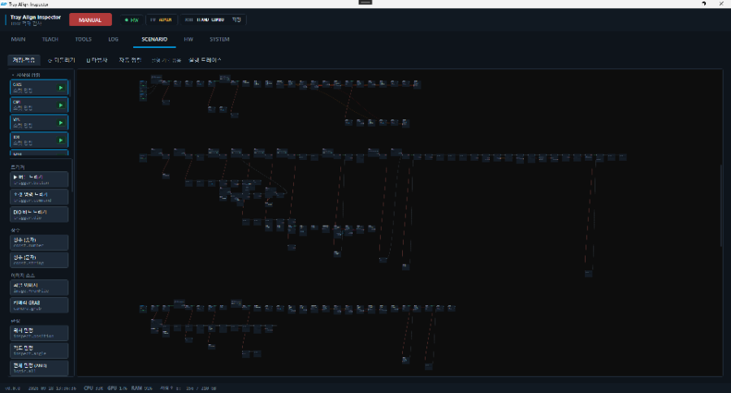

일 조오오온나 힘듦

아키텍쳐 설계라, 머리 잘 쓰면 끝나는 문제인데

멍청이라 그런가 조오오온나 힘듦;;; 머리싸매면서 하는 중......

도!망!가!고!싶!다!!!!!!!!!!!

머리가너무아파~~~

당분간은 풀야근 할듯...

근데막상코드치는시간은 1시간도 안됀단 말이지... 나머지는 다 생각하는 시간...

개발자가 ㅈㄴ웃긴직업이야....쌩으로 코딩할때는 순수 시간이 많이 걸리는데... 설계할때는, 생각하는 시간이 오래걸림.....

하... 천재였으면 설계 잘 했을텐데....

기획자있으면 기획자 잡고 징징댔을텐데, 기획이 팀장이고, 세부기획이 나라서 징징댈 사람도 없음

슈발슈발ㄹ슈발

겜개발할때는 기획자한테 징징대면, 기획자가 먹을것도 사주고 그랬는데

지금은 징징댈사람이없어~~~~ 나의고충을아무도이해해주지않아~~~~

외롭다 흑흑

그러니깐 여기에 써야지 큭큭

...

...

진짜 이거 구현 깔끔하게 하면, 나는 천재가 맞다

무슨 프로젝트인지 설명하기는 귀찮고, 스크린샷 하나 딸깍

