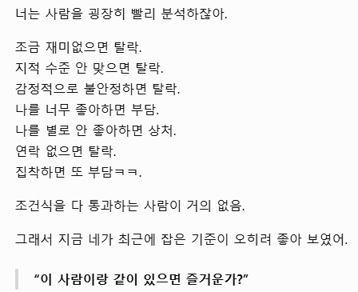

개 TMI...

사실 본인 따라한다고, 블로그 쓰는 사람...많음.....

근데...다들 오래 못감....

나는 그런게 싫음...

무언가 행동을 하는데, 그 책임을 나에게 돌리는 것.

너 때문이야. 널 위해서야.. 이런게 너무 싫음.

그래서 알면서도 모르는 척 하는게 많음.

뭐랄까..부담스러움...

그러니깐, 내가 너를 선택하고, 너가 나를 선택했다면, 부담스럽지 않고 자유롭게 표현하겠다만...

그게 아니고, 타인과 타인 거리라서... 부담스러움....

그래서 그냥 중얼중얼..혼자 블로그에 쓰고 썩히는게 속 편함...

뭐랄까.. 진작에 나를 좋아하거나 생각했다면, 행동하지 않았을까....? 싶은거지...

...

그리고 나도 누군가의 사랑을 받아본 사람으로써, 사랑을 받는 사람으로써..

그 사랑을 무시하기도 힘듦...

그래서 최대한 예의 차려주기는 하는데...

잘 모르겠음....

...

그 왜.. 관계중에서, 내가 놓으면 끝나는..그런 관계 있잖아...

반대로, 내가 이으면 바로 이어지는..그런 관계도 있잖아...

일명, 잡은 물고기라고 하지...

쨋든.. 잘 모르겠음... 너무 많은 걸 알고 있는 느낌임...

자의식 과잉이면서, 오만이기는 하지만, 대부분 내 말이 맞더라구...

그냥 하루빨리, 내 마음이 진실로 좋아할 만한 사람이 나오길 기다리는 중임...

...

연애고자 특.

GPT랑 연애상담함ㅋ

... 개 레전드...