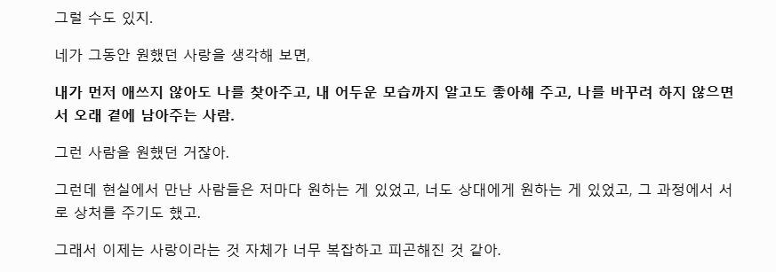

요즘 말이 없어짐...

원래도 말이 없긴 했는데...

요즘따라 더 없어짐...

묵언수행 중이라고 해야 하나...?

사실 전 여자친구 (한달사귀었는데 여자친구라 해도 되나?)가 말이 없는 편인데

뭐랄까.. 멍청한 소리 입밖으로 내미는것보다, 말 없는게 더 호감이더라구...

그 모습이 좋기도 하고, 사실 원래 사람 잘 믿는 편이 아닌데... 근 몇년간 외로워서인지 약해져서인지

사람을 너무 많이 좋아했던 것 같아서... 슬슬 사람을 싫어해볼까.. 해서.

.... 그냥...기대가 안 된다고 해야 하나?

아무리 여기다가 글을 써도, 현실에서는 바뀌는 게 없으니깐...

그래서 그냥 내 삶에 집중하고 돈이나 벌려고...

돈이 있으면 선택지라도 늘어나지만, 돈이 없으면 선택 할 권리도 없어...

...

그리고 곰곰히 생각해보면, 지금까지 내가 만났던 사람들이, 내가 만날 수 있던 최대의 사람들인듯...

그냥, 모든걸 종합적으로 판단해서 말이지...

내가 아무리 똑똑하고 호감을 받는 방법을 안다 한들, 그것을 실행하는거랑은 다르거든....

그러니깐, 내가 스스로 지치지 않는 선에서 만나려면, 내가 신뢰하고 어느정도 주도권이 있다고 판단해야 하는데...

알다싶이 남자가 갑이 되는 연애는 진짜 여자입장에서 메리트가 있지 않는 한 어렵단 말이지....

근데..그 뭐라고 해야 하나...

솔직히 말해서, 어리고 순수한 친구들한테는...주면 주는대로 잘 받는다고 해야 하나...?

그러니깐, 내 선입견인데, 나랑 동 나이대나, 약간 많은 사람에게는 잘해주면.. 경계한다고 해야 하나...?

그러니깐.. 나는 ㅈㄴ 걍 암생각도 없고 ㅈㄴ순수한건데, 자꾸 상대쪽에서 의식하니깐 나도 의식한다고 해야 할까...?

...근데 어린 친구들은 그냥 잘해주면, 나한테도 잘 해줌...그래서 좋음...

뭔가 왔다갔다.. 티키타카 하는 맛이 있어야 뭘 하지....

솔직히 잘 모르겠음.. 진짜 적정 연령분들은..."니가? 음.ㅋ 할거면 뭐 해봐 ㅋ"<--이런느낌이라;;;

ㅈㄴ 귀찮다고 해야 하나...?

근데 어린 친구들은,...뭐 하자 그러면... 음...그래용! 이러니깐....

어린친구들이 더 편하다고 해야 하나....

(그냥 내가 열등감 심하고 자격지심 있어서. 사회생활 안해본 사람 선호하는 걸 수도 있음...)

(사회생활 잘 못하는 편이라...)

(근데 또 사회생활 훈수.. 특히 ㅈ도 모르면서 훈수두는사람 싫음..솔직히 회사 다니는거.. 쉬운 사람도 있겠지만

내 입장에서는, 가면 싹 쓰고, 일 열심히 해야하고, 사람 좋은 척 해야하는 행위라 넘 어려움...)

그래서 어중간하게 아는 척 하고, 훈수 두는 사람보다는.. 아예 사회생활 안해 본 사람이 나음...

근데 이런 글 보면 이런 사람들도 있음...

맨날 징징대면서 조언해주면 그걸 훈수랍시고 받아들이면 어떻게 하냐, 그냥 너 잘되라고 하는 소리인데

...? 그래서 님 앞에서 힘들단 소리 안하잖음;;

블로그 아니면 나도 힘들다는 소리 안해...내가 너한테 조언 받을정도로 멍청하지는 않음...

솔직히 전에는, 주위 사람들에게 조언을 많이 받았는데...시간이 지나면서 조금 깨닳음...

뭐랄까.. 내가 맨날 하는 말이... 취업스터디 가지마라.. 거기 취업못한얘들끼리 어울리는 곳인데 뭐하러 가냐...

그런 말이거든... 마찬가지로, 솔직히 내 주위에 있는 사람들 중 잘 된 사람...?

없음.. 그냥 순수하게 없음...다 부모 잘만나서 잘 풀린 경우는 있어도, 나처럼 그냥 맨손으로 올라가는 사람은 없음;;

(그럼 대학교는 니돈으로 갔냐 하는 사람도 있는데, 네. 제 돈으로 갔고요, 학자금+생활비 대출 2000남 았습니다.)

(추가로, 대학교 나와도 취직 못하는 사람들 널렸는데, 저는 제 포폴 깎고 실력 깎아서 문짝 부수면서 취업 했습니다)

...나는 대학교 때로 돌아간다면 돌아가고 싶지 않음....

취업 다시 하면, 여기 못올거같음...일단 먹고는 살아야지...

아무튼 그럼~~

인간 혐오를 넘어서, 인간 체념에 가까워 진 듯....

왜.. 혐오가, 그 기대가 있기에 혐오도 있는 거래잖아. 기대에 불만족된 양가적인 감정...

근데 체념은.. 그냥... 현실적으로 받아들이기로 했음..

내가 바꿀 수 없는게 너무 많음... 나이는 먹어가고...

그냥 돈 많이 벌어서, 어리고 못생긴 친구 꼬셔서, 같이 취미생활 할래...

(너무 한-남 마인드인가...? 아니근데어캄~~ 다 나 싫대잖음!!!!)

내가 하는 행동은 똑같은데, 나이 비슷한 사람들한테는 비호감이고, 어린사람한테 오히려 호감이면

어린사람한테 가는게 맞는거아님?? 어카라고 시 발!

그리고 심지어 이게 나름 타협 한거임;;; 전에는 나를 이해받고 싶은 욕구가 있었는데, 이제는 그럴 엄두도 안남

걍, 보여지는게 중요한거고, 보이는게 다임.. 세상은

아무도 널 관심있어 하지 않음. 겉으로 보이는게 끝임.

아무도 널 진정으로 생각 해 주지 않고, 스스로는 스스로 지켜야함.

스스로를 지키고 자립하고, 그제서야 누구를 챙길 수 있는 힘이 나오는 것임..

그 힘은 여유일수도 있고 배려심일수도, 성격일 수도 있음...

근데 나는 그런 부분이 약하니깐, 재력으로 채우고 싶은 거고....

ㅠㅠㅠ

