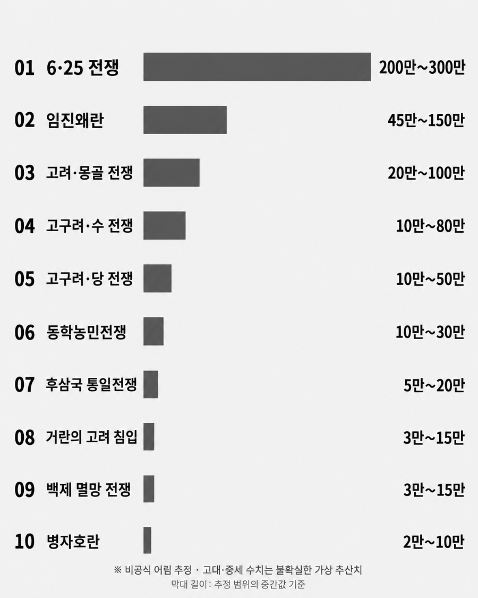

애초에

사랑을 받을 수 있는 사람이 있는거고

사랑을 받을 수 없는 사람이 있는거임..

나처럼 외적이든 내적이든, 모든게 뒤틀려 있는 사람은

호감보다는 혐오에 가까운 감정을 느끼게 됨.

나도 알고 있음.

역겨움.

나는 자존감이 떨어지는게 아님..

그냥 모든 사람을 존중하지 않음.

세계대전때 사망자가 6000만명이라고 함.

나는 생각함.

내가 지금 살아있는것이, 그 6000만명보다 더 나은 삶인가?

그 사람들이 죽었어야 하는게 아니라, 내가 죽었어야 하는게 아닌가?

괜한 죄책감에 시달리게 됨.

아래는 한국사 전쟁별 사망자 수임.

200만~300만이 죽어나간 다음에, 살아있는게 나라고??

라는 생각이 들곤 함.

그래서, 남아있는 사람들은, 전에 있던 사람들을 위해서

모두 죽어줬으면 좋겠음.

하루아침에 그냥

소행성이든 뭐든

지구가 개 박살 났으면 좋겠음