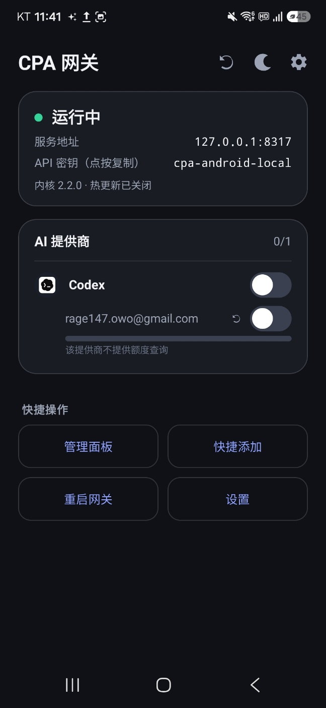
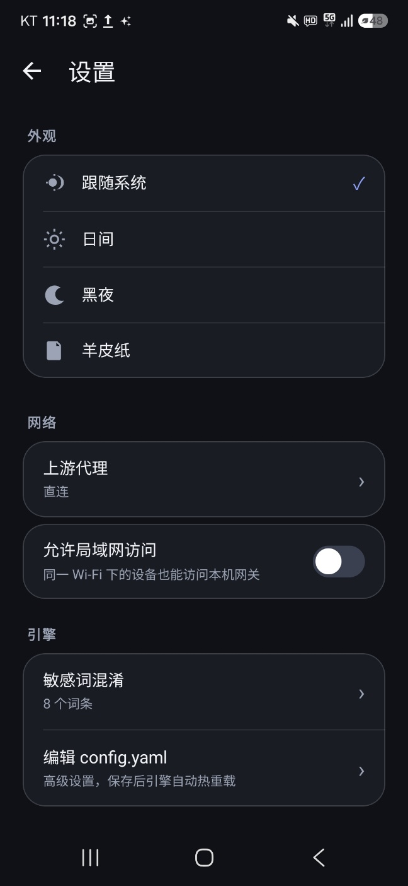
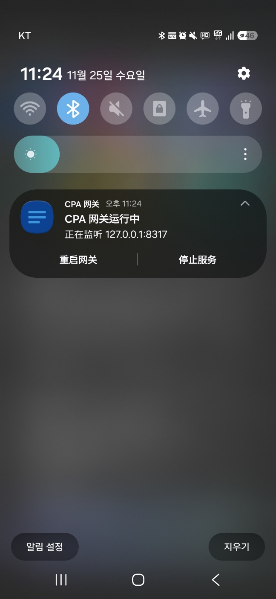

회사에서 AI 엔터프라이즈를 도입했다.

클로드, 코덱스, 코파일럿....

이것 저것 도입을 했는데, 토큰이 월 200달러정도밖에 안되어서, 만성 토큰 부족으로 살고 있다.

아무래도 기업용을 개인보다 3배~5배정도 가격이 더 책정된듯....

쨋든, 도저히 엔터프라이즈로 버틸 수가 없어.. 그냥 회사 짤릴 것 각오하고 개인 API 사용 중...

처음에는 SSH를 연결해서 회사 PC에 접근해서 사용했는데, 이것도 하루이틀이지 좀 힘들더라

그래서 찾아보니, 어짜피 컨텍스트는 앱에서 정리되고, API로 통신하니깐.. 그냥 호스팅만 열면 된다더라...

그래서 뭐 이것저것 하다가~~ 첨에는 노트북에서 호스팅 하다가~~ Model Provider 만 변경해서 쓰는데

더 찾아보니 API를 통합해서 사용하는 CLIProxyAPI 프로토콜이 있고, 여기 리포지토리에서 API 호스팅 할 수 있는 서비스를 이것저것 모아놨대....

그러니깐, 구독형 서비스를, API로 호스팅 가능하게... 하는 것....

이렇게 하면, 클로드나 코덱스나 코파일럿이나.. 이것저것 자유롭게 쓸 수 있다는 장점이 있다.

물론 본인같은 경우는 그냥 단순히 구독형 요금제로 API를 열어 Model Provider로 사용하기 위함이지만....

<https://github.com/sylearn/AIUsage>

[**GitHub - sylearn/AIUsage: One dashboard to manage all your AI subscriptions — track quotas, costs, accounts, Claude Code proxy, and Codex proxy in one place.**

One dashboard to manage all your AI subscriptions — track quotas, costs, accounts, Claude Code proxy, and Codex proxy in one place. - sylearn/AIUsage

github.com](https://github.com/sylearn/AIUsage)

위는 전체 리포지토리고, APP형태는 아래 링크에 있다.

<https://appteka.store/app/a0ar333174>

... 그와중 앱 개발자 개발력 뭔데...

중국씹덕개발자ㄷㄷ;;

쨋든 뭐 설정은 아래처럼 생겼다.

역시 마이너하게, 언어팩은 중국어가 전부... 번역기 돌려서 대충대충 세팅 했다.

아마 내일 회사가서 테스트 해 볼 예정..

+Copilot Model Provider 연결 됨.

근데 Wire API를 chat completions 가 아닌 responses를 사용해야 하고

API Key에 cpa-android-local를 입력해야 한다.

